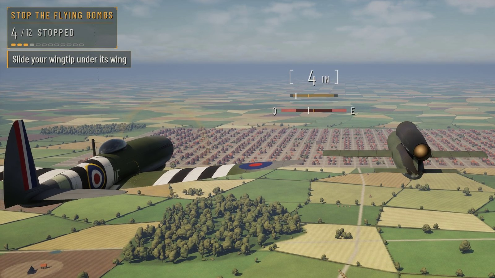
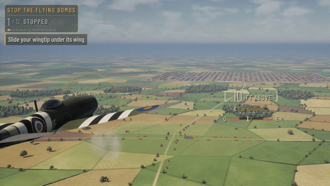
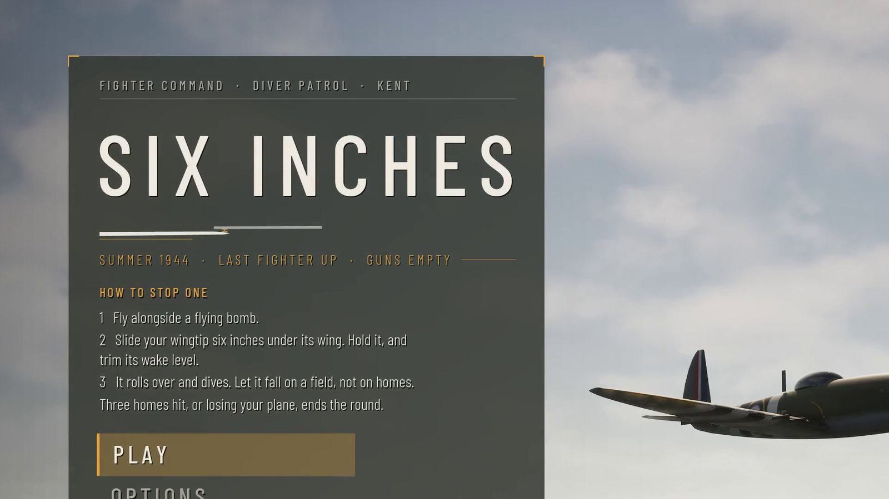
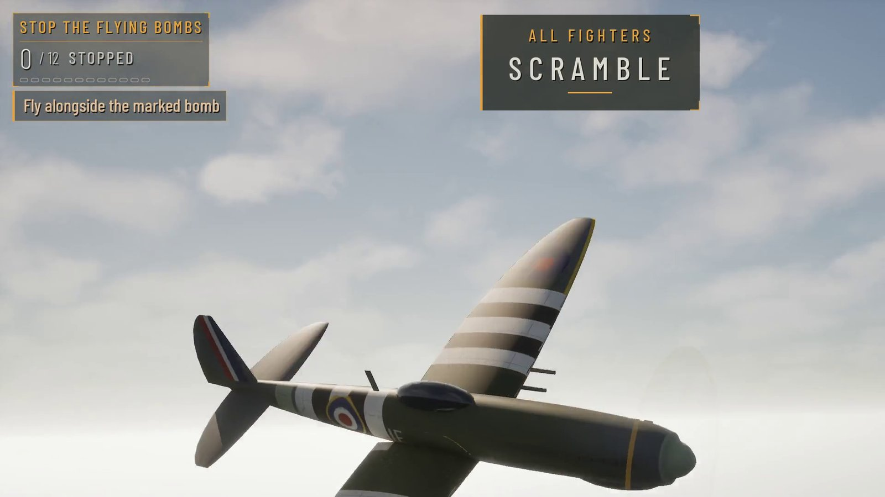
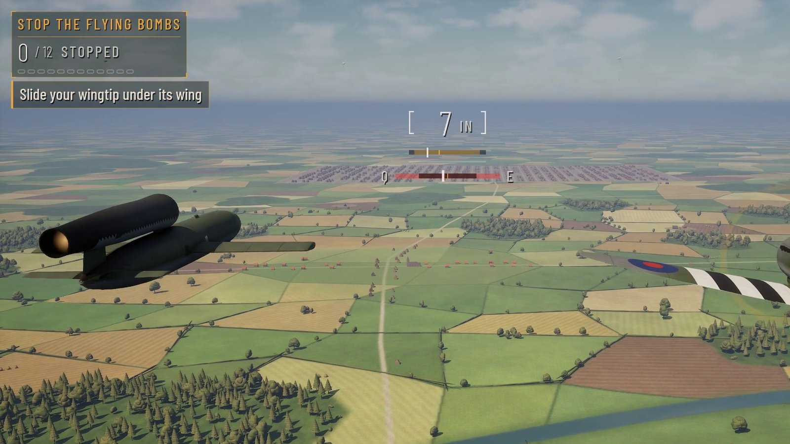
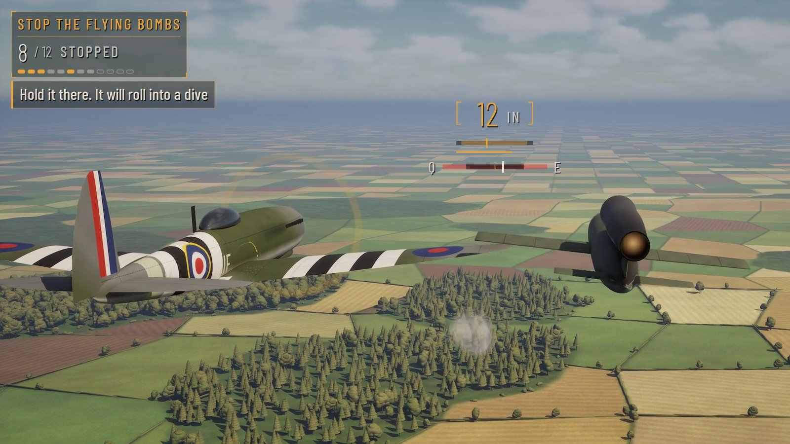

# Wingtip

*Summer 1944. Last fighter up. Guns empty.*

A arcade flight interception game made in **Unreal Engine 5.8** with gameplay written entirely in C++.

The project still uses its working title, **Six Inches** (`SixInches.uproject`), which you'll see on the start screen.

## About

No guns. Stop flying bombs the way real pilots did in 1944: dive from height, slide your wingtip six inches under the bomb's wing and tip it over. Height is speed, precision is everything, and where it falls matters. Hold it too long and it lands on the village; let go early and it's still heading for town.

**Goal:** End the wave with at most one hit (a bomb reaching town or tipped onto a building). Lose on two hits, or if your plane goes down to flak, balloon cables, a collision or the ground.

**[Watch the full gameplay video (MP4, with sound)](media/gameplay.mp4)**

## Controls

| Key | Action |
|---|---|
| W / S | Dive / climb |
| A / D | Bank, slide in and out beside a bomb |
| Q / E | Trim, keep the wake meter level |
| Shift | Boost |
| Space | Airbrake, break off |
| R | Restart |
| Esc | Menu |

## Highlights

- Energy flight: dive for speed, airbrake to match a bomb
- Wingtip tipping with a live ground readout of where the bomb will fall
- Friendly flak, barrage balloons and blast turbulence
- A 16 x 12 km generated countryside

## Screenshots

| | |
|---|---|
|  Start screen |  Scramble |
|  Sliding in beside a flying bomb |  Hold it there: it rolls into a dive |

## Play it

1. Install **Unreal Engine 5.8** (Epic Games Launcher) and **Visual Studio 2022** with the *Game development with C++* workload.
2. Download `Wingtip-UE5.8-project.zip` from the [Releases](../../releases) page and unzip it.
3. Double-click `SixInches.uproject` and say **Yes** when it asks to build the modules.
4. Press **Play** in the editor, or right-click the `.uproject` and choose *Launch game*.

This repository holds the source and config. The levels, art and audio (`Content/`) are only in the release zip, because they are too large for git.

## Project layout

| Folder | What's in it |
|---|---|
| `Source/SixInches/` | all gameplay code (C++) |
| `Config/` | engine, input and game settings, including tuning values |
| `media/` | screenshots for this page |

## Credits and licence

Third-party assets (all free to use and redistribute) are listed with their authors and licences in [CREDITS.md](CREDITS.md). The licence and notice files that came with them are in [licenses/](licenses/) and in the release zip.
The code and original content are **all rights reserved**: see [LICENSE](LICENSE).
